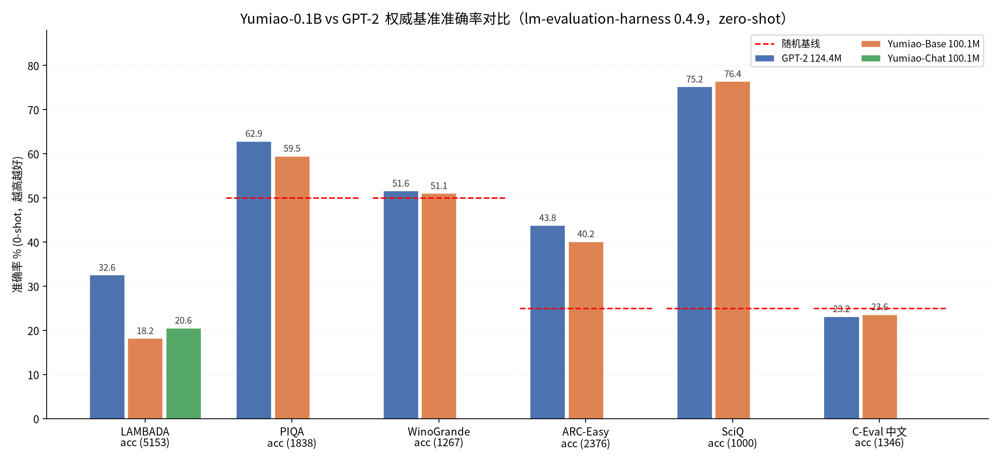
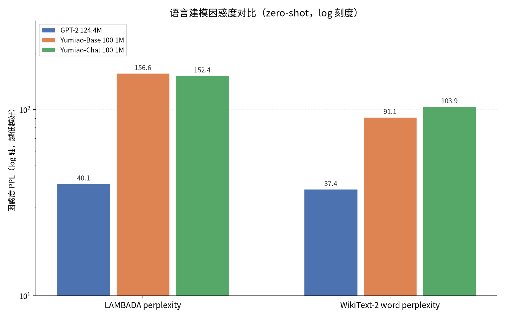

# Yumiao-0.1B

一个从零训练的中文 / 英文小语言模型，参数量 **1.001 亿（0.1B）**，完全自研训练流程：自训 32k BPE 分词器、自建 8B token 语料、自写训练循环，不使用任何现成大模型权重。

- **基座**：`Yumiao-0.1B-Base` — 纯预训练模型，用于续写 / 二次微调
- **对话**：`Yumiao-0.1B-Chat` — 在基座上做自我认知 SFT，支持 ChatML 风格多轮对话
- **HuggingFace**：[Yumiao-0.1B-Base](https://huggingface.co/yumiao-dev/Yumiao-0.1B-Base) ｜ [Yumiao-0.1B-Chat](https://huggingface.co/yumiao-dev/Yumiao-0.1B-Chat)

> 这是一个**学习 / 研究性质**的小模型。它只有 1 亿参数，事实性知识非常有限，**不要**把它当作知识库或生产助手使用。

---

## 1. 模型规格

| 项 | 值 |
|---|---|
| 架构 | LLaMA 式：RMSNorm + RoPE + GQA + SwiGLU（Pre-Norm） |
| 参数量 | 100.1M（含词嵌入，embedding 与 lm_head 权重共享） |
| 层数 / 隐藏维度 | 12 / 768 |
| 注意力 | 12 个 Q 头 / 4 个 KV 头（GQA），head_dim 64 |
| FFN | SwiGLU，中间维 2048 |
| 词表 | 32,000（自训 BPE） |
| 上下文长度 | 1,024 tokens |
| 归一化 | RMSNorm，eps 1e-6 |
| 位置编码 | RoPE，theta = 10000 |
| 精度 | bfloat16 |
| 训练框架 | PyTorch 2.12 + ROCm 7.2（AMD MI308X，gfx942） |

## 2. 训练数据

| 来源 | 语言 | 训练用量 |
|---|---|---|
| Chinese C4（`AI-ModelScope/chinese-c4`） | 中文 | 6.0B tokens |
| FineWeb-Edu（CC-MAIN-2024-10） | 英文 | 3.7B tokens（+ 0.2B 中文维基） |

- 实际训练消耗 **8.0B tokens**（122,000 步 × 65,536 tokens/步）
- 分词后以 uint16 二进制分片存储，共 9.9B tokens / 19 GB
- 数据清洗：HTML 标签剥离、繁简统一、全半角归一、重复段落过滤、长度与符号比例过滤

## 3. 训练过程

| 项 | 值 |
|---|---|
| 优化器 | AdamW（β=0.9/0.95，wd 0.1） |
| 学习率 | 6e-4，2000 步 warmup + 余弦衰减到 10% |
| 批大小 | 64 × 1024 tokens |
| 梯度裁剪 | 1.0 |
| 训练步数 | 122,000 |
| 吞吐 | ≈ 89,500 tokens/s |
| 最终 loss | 2.96（ppl ≈ 19.3） |

## 4. 快速开始

```bash
pip install -U transformers torch accelerate
```

```python
from transformers import AutoModelForCausalLM, AutoTokenizer

model_id = "yumiao-dev/Yumiao-0.1B-Chat"          # 或本地目录
tok = AutoTokenizer.from_pretrained(model_id)
model = AutoModelForCausalLM.from_pretrained(model_id, torch_dtype="bfloat16", device_map="auto")

messages = [{"role": "user", "content": "你是谁？"}]
inputs = tok.apply_chat_template(messages, add_generation_prompt=True, return_tensors="pt").to(model.device)
out = model.generate(inputs, max_new_tokens=128, do_sample=True, temperature=0.8,
                     top_p=0.9, repetition_penalty=1.2)
print(tok.decode(out[0][inputs.shape[-1]:], skip_special_tokens=True))
```

> **务必用采样解码**。贪心解码（`do_sample=False`）在这个尺寸的模型上会迅速陷入复读循环，这是 0.1B 模型的通病，不是权重损坏。

## 5. 对话模板

Chat 版使用如下特殊格式（`tokenizer_config.json` 已内置 `chat_template`，直接调 `apply_chat_template` 即可）：

```
<s><|system|>你是 Yumiao-0.1B，由 yumiao 训练的 1 亿参数语言模型。<|user|>你好<|assistant|>你好！有什么可以帮你的吗？</s>
```

特殊 token：`<pad>`(0) `<s>`(1) `</s>`(2) `<unk>`(3) `<|system|>`(4) `<|user|>`(5) `<|assistant|>`(6)

## 6. 效果与局限

**能做到**

- 流畅的中文 / 英文续写，语法与搭配基本正确
- 简单的自我认知问答（名字、参数量、训练者、架构、知识截止时间）
- 极短的常识问答与简单算术（两位数加法，且不稳定）

**做不到（实测）**

- 事实性知识基本不可靠：问首都会答"上海"，问国家会张冠李戴
- 三位数以上算术几乎全错
- 长上下文（>512 token）后容易跑题
- 没有代码能力、没有指令泛化能力，训练数据中代码占比极低

SFT 版用约 1,000 条身份数据 + 3,000 条通用指令训练 1 个 epoch（500 步，lr 5e-5，最终 loss 2.43）。身份问答命中率高，但通用指令遵循仍很弱。

## 7. 文件清单

| 文件 | 说明 |
|---|---|
| `model.safetensors` | bf16 权重，200 MB，可直接 `from_pretrained` |
| `config.json` | LLaMA 架构配置，`architectures: LlamaForCausalLM` |
| `tokenizer.json` | 32k BPE 词表与合并规则 |
| `tokenizer_config.json` / `special_tokens_map.json` | 分词器配置与特殊 token，含 chat template |
| `generation_config.json` | 推荐采样参数 |

## 8. 引用

```bibtex
@misc{yumiao2026yumiao01b,
  title  = {Yumiao-0.1B: A 100M Parameter Chinese-English Language Model Trained From Scratch},
  author = {yumiao},
  year   = {2026},
  note   = {10B-token scale pretraining on AMD MI308X}
}
```

## 9. 许可

Apache License 2.0。可自由用于研究、商用与二次训练。

## 10. 评测（vs GPT-2）

lm-evaluation-harness 0.4.9 · zero-shot · CPU fp32，与 Open LLM Leaderboard 同款脚本。完整报告、原始分数与对话记录在 [`eval/yumiao-vs-gpt2`](eval/yumiao-vs-gpt2/)，16 份 lm-eval 原始 `results.json` 在 [`eval/yumiao-vs-gpt2/raw`](eval/yumiao-vs-gpt2/raw/)。

| 任务 | 指标 | 随机基线 | GPT-2 124M | Yumiao-Base 100M |
|---|---|---|---|---|
| LAMBADA | acc ↑ | — | 32.56% | 18.20% |
| PIQA | acc ↑ | 50.0% | 62.89% | 59.52% |
| WinoGrande | acc ↑ | 50.0% | 51.62% | 51.07% |
| ARC-Easy | acc ↑ | 25.0% | 43.81% | 40.15% |
| SciQ | acc ↑ | 25.0% | 75.20% | 76.40% |
| C-Eval（中文） | acc ↑ | 25.0% | 23.18% | 23.63% |
| LAMBADA | ppl ↓ | — | 40.06 | 156.61 |
| WikiText-2 | ppl ↓ | — | 37.37 | 91.13 |

英文基准上 GPT-2 占优（5 胜 3 平），中文生成与身份对话 Yumiao 占优；两者中文知识选择题都接近随机。




